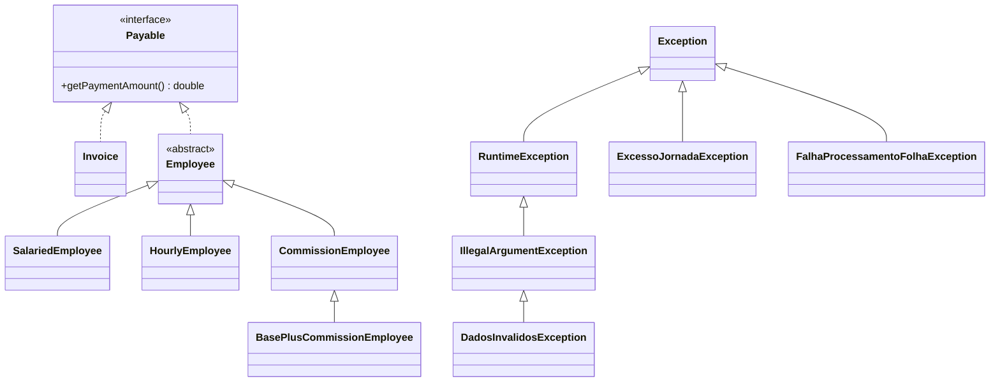

# Sistema de Folha de Pagamento e Processamento de Contas (`Payable`)

Projeto acadêmico desenvolvido na disciplina de **Programação Orientada a Objetos em Java** (ADS — 4º Semestre), com foco em **polimorfismo**, **interfaces**, **hierarquia de exceções customizadas**, **propagação na pilha de chamadas (*call stack*)** e **controle transacional com *rollback* baseado em Pilha (LIFO)**.

Este repositório consolida e refatora os requisitos definidos nos dois enunciados do trabalho:
- [Enunciado 01 — Trabalho de Implementação (Folha de Pagamento Polimórfica e Interface `Payable`)](./02%20-%20Enunciados/Enunciado_01.pdf)
- [Enunciado 02 — Refatoração (Tratamento de Exceções, Pilha de Execução e Regras de Negócio)](./02%20-%20Enunciados/Enunciado_02.pdf)

---

## 🎯 Objetivos do Projeto

- Aplicar **herança, polimorfismo e interfaces** no cálculo semanal da folha de pagamento e contas a pagar (`Payable`).
- Projetar hierarquias de exceções personalizadas estendendo `Exception` (*checked*) e `RuntimeException` / `IllegalArgumentException` (*unchecked*).
- Dominar o uso de `throw`, `throws`, blocos `try-catch-finally` e **encadeamento de exceções** (*exception chaining / cause*).
- Garantir **conformidade trabalhista e auditoria**, sinalizando violações de jornada extra.
- Utilizar estrutura de dados de **Pilha** (`Deque<Payable>` / `ArrayDeque` ou `Stack<Payable>`) para rastreamento e **reversão (*rollback*) em lote** no caso de falhas de processamento.

---

## 📋 Especificação dos Requisitos

### 1. Domínio da Folha de Pagamento e Contas (`Enunciado 01`)

A empresa realiza pagamentos semanais de forma **polimórfica** por meio da interface `Payable` (`getPaymentAmount(): double`), abrangendo faturas (`Invoice`) e quatro categorias de funcionários (`Employee`):

| Categoria | Regra de Cálculo Semanal |
| :--- | :--- |
| **Assalariado** (`SalariedEmployee`) | Salário fixo semanal, independentemente das horas trabalhadas. |
| **Horista** (`HourlyEmployee`) | Valor por hora para até 40 horas normais; adicional de **1,5x** sobre o valor da hora para horas extras excedentes. |
| **Comissionado** (`CommissionEmployee`) | Porcentagem de comissão aplicada sobre o total de vendas. |
| **Assalariado/Comissionado** (`BasePlusCommissionEmployee`) | Salário-base + porcentagem sobre vendas, com **bonificação de +10%** adicionada ao salário-base no período salarial atual. |
| **Fatura / Conta** (`Invoice`) | Valor calculado com base na quantidade e no preço unitário do item. |

> **Conformidade Trabalhista:** Todo pagamento gerado com registro de mais de **2 horas extras diárias** (acima de 10 horas totais no dia: 8h normais + 2h extras) deve disparar uma exceção *checked* e ser **marcado na folha / relatório de auditoria** para evidenciar possíveis passivos trabalhistas.

---

### 2. Hierarquia de Exceções Customizadas (`Enunciado 02 — Parte 1`)

1. **`ExcessoJornadaException`** (*Checked* — estende `Exception`)
   - Disparada sempre que o registro diário de um `HourlyEmployee` ultrapassar o limite legal de **2 horas extras** (> 10 horas totais no dia).
   - Armazena e disponibiliza via *getters*: nome do colaborador, data/dia do registro, quantidade de horas lançadas e limite legal permitido.

2. **`DadosInvalidosException`** (*Unchecked* — estende `IllegalArgumentException`)
   - Disparada em validações básicas de domínio, como:
     - Valor de hora ou salário-base negativo;
     - Porcentagem de comissão fora da faixa de `0` a `100%`;
     - Fatura (`Invoice`) com valor negativo ou quantidade menor ou igual a zero (`<= 0`).

3. **`FalhaProcessamentoFolhaException`** (*Checked* — estende `Exception`)
   - Exceção de alto nível lançada pela camada de serviço (`PayrollService`).
   - Encapsula a exceção original utilizando encadeamento de causa raiz (`super(mensagem, causa)`).

---

### 3. Arquitetura em 3 Camadas e Propagação (`Enunciado 02 — Parte 2`)

O fluxo de chamadas e tratamento de erros segue a propagação explícita pela pilha de execução (*call stack*):

1. **Nível 1 — Entidade / Domínio (`HourlyEmployee`, `Invoice`, etc.)**
   - Valida invariantes e regras trabalhistas.
   - `HourlyEmployee` valida a carga diária sem engolir o erro com `catch`: declara `throws ExcessoJornadaException` e dispara a exceção via `throw`.
   - `Invoice` valida quantidade e preço unitário, lançando `DadosInvalidosException` em caso de valores inválidos.
2. **Nível 2 — Serviço / Regra de Negócio (`PayrollService`)**
   - Processa lotes de pagamentos (`Payable[]`).
   - Ao capturar `ExcessoJornadaException`, registra o apontamento para auditoria trabalhista (marcação na folha) e relança como `FalhaProcessamentoFolhaException` encapsulando a causa original.
3. **Nível 3 — Visão / Entrada (`Main`)**
   - Ponto de entrada que captura as falhas finais, exibe o *stack trace* de forma amigável no console e apresenta o estado final do sistema.

---

### 4. Controle Transacional e Rollback com Pilha (`Enunciado 02 — Parte 3`)

- Classe utilitária **`HistoricoTransacoes`** contendo internamente uma estrutura de **Pilha** (`Deque<Payable>` ou `Stack<Payable>`).
- **Fluxo de processamento em lote (`Payable[]`):**
  1. Cada pagamento concluído com sucesso é **empilhado** (`push`) no histórico.
  2. Caso ocorra uma exceção durante o lote, o bloco `catch` aciona a rotina de **reversão (*rollback*)**.
  3. O *rollback* **desempilha** (`pop`) todos os pagamentos já efetuados, executando o estorno de cada um em ordem **LIFO (*Last-In, First-Out*)**.
  4. Um bloco **`finally`** obrigatório encerra o ciclo de auditoria, exibindo o resumo final (operações concluídas vs. estornadas) e garantindo o fechamento/descarga dos recursos de log.

---

## 🧩 Diagrama de Classes (Visão Geral)



> O diagrama editável do projeto encontra-se em [`01 - Diagramas/Diagrama_classes_01.drawio`](./01%20-%20Diagramas/Diagrama_classes_01.drawio).

---

## 🧪 Cenários de Teste Obrigatórios (`main`)

A classe principal (`public static void main(String[] args)`) deve demonstrar três cenários:

1. **Caminho Feliz:** Processamento bem-sucedido de pagamentos válidos contendo `Invoice`, `SalariedEmployee` e `HourlyEmployee` dentro do limite legal (além dos demais perfis da folha).
2. **Violação Trabalhista (*Checked Exception*):** Submissão de um `HourlyEmployee` com registro diário de **12 horas**, disparando `ExcessoJornadaException`, capturando no `PayrollService`, registrando a pendência na auditoria trabalhista e exibindo a pilha de chamadas (*stack trace*).
3. **Falha em Lote com *Rollback* (Pilha LIFO):** Processamento de um lote com **5 pagamentos** em que o **4º item falha**. O sistema empilha os 3 primeiros pagamentos e, diante da falha, desempilha e estorna um a um na ordem inversa (3º → 2º → 1º), encerrando com o resumo no bloco `finally`.

---

## 📁 Estrutura do Repositório

```text
Trabalho_Refatoracao_Revisao/
├── 01 - Diagramas/
│   └── Diagrama_classes_01.drawio   # Diagrama de classes do projeto
├── 02 - Enunciados/
│   ├── Enunciado_01.pdf             # Enunciado base (polimorfismo e interface Payable)
│   └── Enunciado_02.pdf             # Enunciado de refatoração (exceções, call stack e rollback)
└── README.md                        # Documentação do projeto
```
